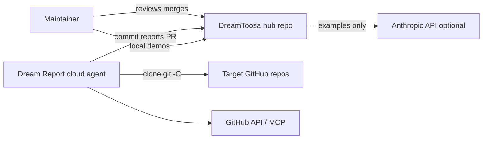
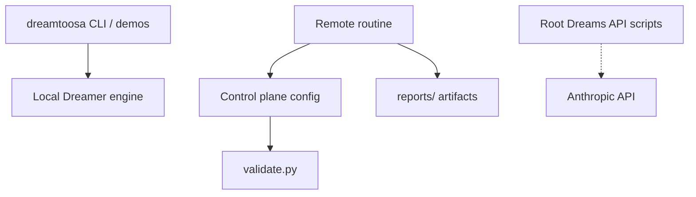
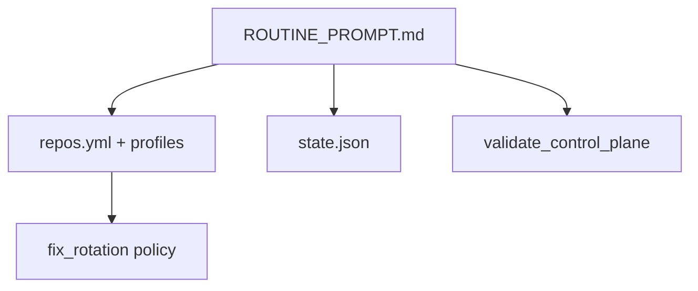

# Master Architecture

> Treat this file as high-priority architecture memory. Read it before changing system boundaries, platform wiring, data flow, deployment, security, or observability.
>
> Do not store secrets, private keys, tokens, credentials, customer data, or private infrastructure values here.

## 1. Architecture Goal

DreamToosa is the **hub control plane** for the scheduled **Dream Report** maintainer routine and a **Python reference** for local/remote Claude Dreams memory curation.

- **Who:** Portfolio maintainer (human) plus cloud and local AI agents.
- **Optimizes for:** One consolidated daily health report, bounded fix PRs, resumable cross-run state, and educational clarity in examples.
- **Constraints:** No hosted orchestrator; routine sandbox clones targets at `/home/user/<repo>`; GitHub MCP may be read-only; AgToosa target is review-only while its PR backlog drains.

## 2. Quality Attributes

| Attribute | Target | Current Evidence | Risk |
|-----------|--------|------------------|------|
| Reliability | Routine completes or degrades cleanly | `state.json`, read-only mode, hub circuit breaker, PR chaining (DEV-004) | MCP 401 blocks remote PR/issue automation |
| Security | No secrets in repo; validated manifest | `validate.py`, AgToosa review workflows, placeholder IDs in examples | Untrusted repo content in routine prompts |
| Maintainability | Clear module boundaries | `dreamtoosa/` package vs root API examples; AGENTS.md map; canonical remote client in `dreams_implementation.py` (DEV-005) | `dream_example.py` still carries a parallel orchestrator path |
| Performance | Per-repo time box | `budget.soft_time_box_minutes_per_repo` in repos.yml | Five-repo runs may exceed wall clock |
| Operability | Reports + CI signal | `reports/`, GitHub Actions validate workflow | No production metrics stack in hub |

## 3. C4-style Diagrams

### 3.1 System Context

### 3.2 Containers

### 3.3 Components

## 4. Containers and Components

| Area | Responsibility | Key Files | Owner / Boundary |
|------|----------------|-----------|------------------|
| Control plane | Targets, caps, hub policy | `dreamtoosa/repos.yml`, `profiles/` | Hub only |
| Cross-run memory | Last SHAs, rotation, skips | `dreamtoosa/state.json` | Committed with reports |
| Routine contract | Phases 0–6 behavior | `dreamtoosa/ROUTINE_PROMPT.md` | Sync to RemoteTrigger manually |
| Validation | Structural invariants | `dreamtoosa/validate.py`, `tests/test_validate.py` | CI + routine |
| Local curation | Offline memory engine | `dreamtoosa/dreamer.py`, `tests/test_dreamer.py` | Package boundary |
| Remote examples | Historical API patterns | `dreams_*.py`, `dream_example.py` | Not imported by validator CI path |

## 5. Data Flow

1. **RemoteTrigger** starts the routine with `persist_session=false`.
2. Agent reads `repos.yml`, `state.json`, and `ROUTINE_PROMPT.md`; runs `validate.py`.
3. For each enabled repo: `git -C <clone>` log/diff per profile; optional tests per profile.
4. Agent writes `reports/<repo>/dream-report-<date>.md` and index; updates `state.json`.
5. Hub opens ≤1 report PR (chain strategy) and ≤1 fix PR on rotated eligible target unless read-only or circuit breaker trips.

## 6. Deployment

| Environment | Runtime | Build / Release | Configuration |
|-------------|---------|-----------------|---------------|
| Local | Python 3.8+ | `python3 -m unittest discover -s tests` | `ANTHROPIC_API_KEY` for API demos |
| CI | GitHub Actions ubuntu | `control-plane.yml` | No API key required |
| Routine sandbox | Anthropic Cloud | Routine trigger `trig_01PvQiwSRhJktFxMXwxf14Qi` | Sources list + `DREAMTOOSA_CLONE_ROOT` |

## 7. Security

| Concern | Current Control | Architecture Note |
|---------|-----------------|-------------------|
| Authentication / authorization | GitHub MCP / gh in routine | READ_ONLY on 401; no push in degraded mode |
| Secrets | Env vars only | `ANTHROPIC_API_KEY`; never commit `.env` |
| Input validation | `validate.py` on manifest/state | 19 invariant checks |
| Data protection | Public OSS repos | Reports may summarize findings—review before merge |
| Prompt injection | Routine treats clone content as data | Documented in AgToosa agent rules |

## 8. Observability

| Signal | Where Emitted | How Reviewed |
|--------|---------------|--------------|
| Logs | Routine run log (RemoteTrigger) | `list_runs` / `get_run_log` (DEV-001 proof) |
| Metrics | None in hub | N/A |
| Traces | None in hub | N/A |
| Audit / release evidence | `reports/`, CHANGELOG, Master-Plan | `/agtoosa-ship`, dream reports |

## 9. Decision Links

| Decision | Link | Status |
|----------|------|--------|
| PR chaining & hub circuit breaker | Master-Plan DEV-004 decisions | Shipped |
| AgToosa fix_eligible false | `dreamtoosa/repos.yml` | Active |
| Local vs remote Dreams docs | PR #17 / issue #8 | Shipped (docs) |

## 10. Maintenance Rules

- Update this file when changing `repos.yml` schema, routine phases, or package boundaries.
- Read during `/agtoosa-spec plan`, `/agtoosa-build`, and `/agtoosa-review arch`.
- Keep Mermaid diagrams in sync when adding a sixth container or new external integration.
