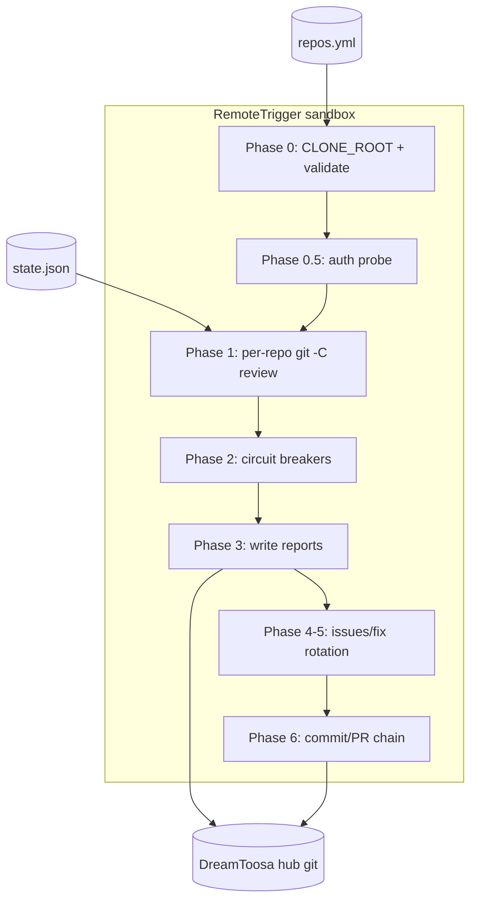

# Spec: DEV-001 — Multi-Repo Control Plane for the Dream Report Routine

> **Story ID:** DEV-001  
> **Epic:** DEV-100 (Multi-repo maintainer routine)  
> **Status:** 🏁 Shipped  
> **Estimate:** M  
> **Clarity:** `sa-ready` (architecture + STRIDE added R1; test plan pending `/agtoosa-spec tasks`)  
> **Spec created:** 2026-09-07  

---

### Plan-Mode Spec Interview (findings)

#### Inferred (≥80% — no question asked)

| Checklist area | Finding |
|----------------|---------|
| Control plane shape | Hub repo holds `repos.yml`, five stack profiles, `state.json`, `validate.py`, and canonical `ROUTINE_PROMPT.md`; routine trigger `trig_01PvQiwSRhJktFxMXwxf14Qi` runs daily in cloud sandbox. |
| Resilience | DEV-004 shipped PR chaining, hub circuit breaker, read-only degradation, and validator tests — DEV-001 runtime behavior depends on these invariants. |
| Targets | Enabled repos: AgToosa (review-only), Agtoosa2, Crapsino, DreamToosa, miToosa per manifest as of 2026-10-03 state. |
| Trust boundaries | Untrusted clone content, GitHub MCP credentials, and maintainer-authored prompt text cross agent ↔ GitHub ↔ hub git boundaries. |

#### Documented assumptions

- DEV-001 closure does not require merging downstream target PRs automatically (charter non-goal).
- RemoteTrigger run log attachment is sufficient proof artifact alongside populated `reports/` (charter Proof / evidence).
- Duplicate Dreams client modules remain out of scope for DEV-001 (tracked as DEV-005).

---

## 1. Requirements

### Goal Contract

| Field | Value |
|-------|-------|
| Goal | Establish DreamToosa as the centralized control plane for the multi-repo maintainer routine ("Dream Report – Daily Code Review"). |
| User outcome | A scheduled agent reviews multiple repositories daily, writes one consolidated health report, and performs at most one bounded fix PR per run without accumulating runaway backlogs. |
| Success condition | Control plane configuration (`repos.yml`, `profiles/`, `state.json`, `ROUTINE_PROMPT.md`); circuit breaker skips backlogged repos; exactly one fix-eligible repo carries fix work per run via rotation. |
| Proof / evidence | RemoteTrigger `list_runs` + `get_run_log` showing `git -C` per clone; `reports/<repo>/` populated for all enabled targets; `state.json` rotation advance; validator + unit tests green on `main`. |
| Non-goals | Merging PRs on the user's behalf; consolidating all legacy Dreams docs; hosted orchestrator. |
| Assumptions | Sandbox clones at `/home/user/<name>` unless `DREAMTOOSA_CLONE_ROOT` set; GitHub MCP injected in routine runtime. |
| Risks | AgToosa PR backlog; MCP 401 read-only runs; five-repo wall-clock vs budget caps. |
| Unresolved questions | Attach latest RemoteTrigger proof artifact to close DEV-001 (task 5 in Master-Plan). |

### 1.1 User Stories

- **As a** portfolio maintainer, **I want** one manifest and state file on the hub **so that** every routine run resumes from last-reviewed SHAs instead of re-deriving history.
- **As a** maintainer, **I want** per-stack review profiles **so that** shell, Python, Dart, and web targets are evaluated with appropriate checks.
- **As a** maintainer, **I want** circuit breakers and fix rotation **so that** backlogged repos are reported but not flooded with new fix PRs.

### 1.2 Acceptance Criteria (EARS)

| ID | EARS | Priority |
|----|------|----------|
| AC-001 | **WHEN** the control plane initializes, **THE SYSTEM SHALL** load targets, per-repo caps, hub policy, and run budget from `dreamtoosa/repos.yml`. | Must |
| AC-002 | **WHEN** reviewing a repository, **THE SYSTEM SHALL** apply the stack criteria from `dreamtoosa/profiles/<profile>.md` named in the manifest. | Must |
| AC-003 | **WHEN** a routine run completes, **THE SYSTEM SHALL** persist last-reviewed SHAs, rotation index, skips, and issues/PR metadata in `dreamtoosa/state.json` aligned with manifest repos. | Must |
| AC-004 | **WHEN** executing the routine, **THE SYSTEM SHALL** use `git -C` against each clone and GitHub MCP tools per `dreamtoosa/ROUTINE_PROMPT.md`. | Must |
| AC-005 | **WHEN** `python3 dreamtoosa/validate.py` runs, **THE SYSTEM SHALL** pass all manifest/state/profile invariants (agent-instructed; CI-enforced via `.github/workflows/control-plane.yml`). | Should |

_Legacy IDs AC-1..AC-4 map 1:1 to AC-001..AC-004._

### 1.3 Out of Scope

- Unifying `DreamsClient` / `DreamConfig` implementations (DEV-005).
- Changing AgToosa application code inside the AgToosa repository.
- Automatic merge of hub or target PRs without human review.

---

## 2. Design

### 2.1 Architecture Blueprint

**Containers (hub repository)**

| Layer | Responsibility | Key artifacts |
|-------|----------------|---------------|
| Manifest | Targets, caps, hub policy, budget | `dreamtoosa/repos.yml` |
| Profiles | Per-stack review rubric | `dreamtoosa/profiles/*.md` |
| State | Cross-run memory (routine has no session persistence) | `dreamtoosa/state.json` |
| Policy engine | Invariant validation | `dreamtoosa/validate.py`, `tests/test_validate.py` |
| Routine contract | Phased maintainer behavior | `dreamtoosa/ROUTINE_PROMPT.md` → RemoteTrigger |
| Outputs | Dated reports + index | `reports/`, `reports/<repo>/` |

**Files — create (if missing)**

- `dreamtoosa/profiles/python-spec-driven.md` — Agtoosa2 profile (done).
- `reports/**` — per-run artifacts (ongoing).

**Files — change (closure only)**

- `Docs/archived/evidence-DEV-001.md` — optional evidence ledger at `/agtoosa-evidence` (recommended before ship).
- `Docs/Master-Plan.md` — ship row when DEV-001 closes.

**Modularity / OOP**

- `dreamtoosa/dreamer.py` — local `Dreamer` + `MemoryStore` (DEV-003); separate from control-plane manifest path.
- Validators as functions (`validate_control_plane`) keep files under 500 lines; no new god-modules for DEV-001 closure.

**Dependencies**

- Python 3.8+ stdlib for hub validation and local curation tests.
- PyYAML implied by validator for `repos.yml` (existing).
- Anthropic SDK only in root Dreams **examples** — not required for control-plane CI.

**Parallel build lanes (remaining closure)**

| Lane | Work | Depends on |
|------|------|------------|
| A | Capture RemoteTrigger proof log | Maintainer console access |
| B | `/agtoosa-spec tasks` + test plan for AC-001..AC-004 | This plan (R1) |
| C | `/agtoosa-ship` DEV-001 | A + B + green CI |

### 2.2 Data Flow



1. Routine loads manifest + state; runs `validate.py` (fail-fast).
2. For each enabled repo: resolve clone under `CLONE_ROOT`, `git log`/`diff` since `last_reviewed_sha`, run profile verification commands when defined.
3. Write per-repo and consolidated reports; update `state.json` (repos reviewed, rotation, skips).
4. If `READ_WRITE` and caps allow: push chained report branch and at most one fix PR on rotated eligible target.
5. Maintainer merges hub PR; next run reads updated `state.json` from chained branch or `main`.

### 2.3 Threat Model (STRIDE)

| Threat | Category | Mitigation |
|--------|----------|------------|
| Malicious or prompt-injected content in a target repo steers the agent | Tampering | Treat clone file content as data; ROUTINE_PROMPT prohibits executing untrusted instructions; human review of hub PRs |
| Forged or stale manifest/state committed to hub | Tampering | `validate.py` parity checks (repo list, rotation order, caps); CI on every push to `main` |
| GitHub MCP credential theft or misuse in logs | Information disclosure | No secrets in repo; READ_ONLY on 401; redact tokens in reports |
| Routine pushes unbounded report/fix branches | Denial of service | `hub.max_unmerged_report_prs`, per-repo `max_open_prs`, `budget.max_prs_per_run` |
| Agent pushes to origin without PR visibility | Repudiation | READ_ONLY when API auth fails; no orphan push policy in ROUTINE_PROMPT (DEV-004) |
| Maintainer tricked into merging harmful report PR | Elevation of privilege | Human merge gate; non-goal: no auto-merge |
| Loss of audit trail for routine runs | Repudiation | RemoteTrigger run logs + committed `reports/` + `state.json` lineage (proof artifact AC) |

### 2.4 Build Scope

```
✅ Ready to proceed — Scope Boundary (brownfield — implementation largely on main)
Files in scope      : dreamtoosa/repos.yml, dreamtoosa/state.json, dreamtoosa/ROUTINE_PROMPT.md, dreamtoosa/validate.py, dreamtoosa/profiles/*, reports/**
Directories in scope: dreamtoosa/, reports/, tests/, Docs/archived/
Out of scope        : Target repo application source (AgToosa, Crapsino, etc.); Dreams client unification (DEV-005); auto-merge
```

---

## 3. Tasks

> Task tree and wave plan for remaining DEV-001 closure will be regenerated via `/agtoosa-spec tasks`. Master-Plan `## Active Tasks` currently tracks 4/6 through proof + ship.

### Wave Plan (draft — confirm in `/agtoosa-spec tasks`)

| Wave | Goal | Exit criteria |
|------|------|----------------|
| W1 | Proof | RemoteTrigger log stored under `Docs/archived/` or evidence ledger; references `git -C` for five repos |
| W2 | Test plan | `Docs/AgToosa_TestPlan-DEV-001.md` maps AC-001..AC-004 to unittest/validator commands |
| W3 | Ship | `/agtoosa-ship` moves DEV-001 to Completed This Cycle |

---

## Spec Revision Log

| R# | Date | What changed | Why | Approval |
|----|------|--------------|-----|----------|
| R1 | 2026-10-13 | Added §1 EARS ACs, §2 Architecture/Data Flow/STRIDE/Build Scope, §3 wave draft, interview findings | `/agtoosa-spec plan` — readiness gate | approved |

---

## ✅ Spec Approved

- **Approved by:** Chicademy & Navid  
- **Timestamp:** 2026-09-07T21:00:00Z  
- **Note:** R1 design sections added 2026-10-13; Must ACs unchanged.

## ✅ Amendment R1 Approved

Approved: 2026-10-13 23:45
