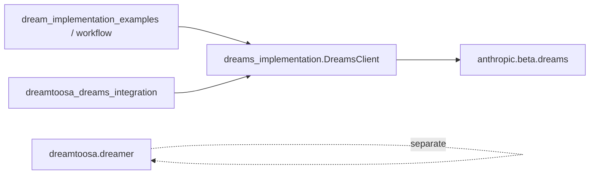

# Spec: DEV-005 — Unify duplicate DreamsClient / DreamConfig modules

> **Story ID:** DEV-005  
> **Epic:** DEV-101 (Claude Dreams memory curation)  
> **Status:** 🟨 In Progress  
> **Estimate:** M  
> **Clarity:** `ready` (post-interview)  
> **Spec created:** 2026-10-13  

---

### Plan-Mode Spec Interview (findings)

#### Inferred (≥80% — no question asked)

| Checklist area | Finding |
|----------------|---------|
| Canonical remote client | `dreams_implementation.py` is already documented as primary in README, AGENTS, START_HERE. |
| Local boundary | `dreamtoosa/dreamer.py` stays separate (offline `Dreamer` / `MemoryStore`). |
| Integration module | `dreamtoosa_dreams_integration.py` duplicates `beta.dreams` calls; should delegate to `DreamsClient`, not define another client class. |
| `dream_example.py` | Uses standalone `DreamOrchestrator` — out of scope unless it imports duplicate `DreamConfig`; optional follow-up. |

#### Asked & confirmed

| Q# | Question | Answer |
|----|----------|--------|
| Q1 | DEV-005 optimization | **B** — Single implementation; merge logic; update imports and guides |
| Q2 | Import compatibility | **A** — Clean break; delete/gut duplicates; update in-repo imports and active docs |
| Q3 | Canonical location | **A** — Root `dreams_implementation.py`; delete `dreams_client.py`; integration imports canonical client only |

#### Documented assumptions

- **`DreamWorkflow`** moves to `dream_implementation_examples.py` (or new `dreams_workflow.py`) using canonical `DreamsClient`; not left in deleted `dreams_client.py`.
- **`Docs/legacy_dreams/`** — update import examples to `dreams_implementation` (clean break includes archived doc snippets that still teach API usage).
- **Tests** — add `tests/test_dreams_implementation.py` with mocked Anthropic client (no network in CI); keep `py_compile` on all touched modules.
- **`dream_example.py`** — unchanged in DEV-005 unless import audit shows `dreams_client` usage (currently independent orchestrator).

---

## 1. Requirements

### Goal Contract

| Field | Value |
|-------|-------|
| Goal | One canonical remote `DreamConfig` / `DreamsClient` implementation for the Dreams API examples in this repo. |
| User outcome | Contributors and agents import a single module for remote dreaming; no parallel client classes with divergent behavior. |
| Success condition | Exactly one definition of `DreamConfig` and `DreamsClient` in production example code; `dreams_client.py` removed; `dreamtoosa_dreams_integration.py` uses the canonical client for dream create/poll paths; docs and profiles reference one import path. |
| Proof / evidence | `python3 -m unittest discover -s tests` green; `python3 -m py_compile` on touched files; grep shows no `class DreamConfig` / `class DreamsClient` outside `dreams_implementation.py`. |
| Non-goals | Merging local `Dreamer` into remote client; rewriting `dream_example.py` orchestrator; API or packaging publish to PyPI. |
| Assumptions | `anthropic` SDK remains the only remote dependency; behavioral merge favors `dreams_implementation.py` with any missing helpers ported from `dreams_client.py` before delete. |
| Risks | Subtle API behavior differences between deleted client and canonical module; legacy doc drift. |
| Unresolved questions | None — interview complete. |

### 1.1 User Stories

- **As a** contributor, **I want** one import path for remote Dreams **so that** I do not choose between three equivalent clients.
- **As a** maintainer, **I want** domain integration to call the shared client **so that** API fixes happen in one place.

### 1.2 Acceptance Criteria (EARS)

| ID | EARS | Priority |
|----|------|----------|
| AC-001 | **WHEN** a developer imports remote dream types, **THE SYSTEM SHALL** expose `DreamConfig` and `DreamsClient` only from `dreams_implementation.py`. | Must |
| AC-002 | **WHEN** the repository is searched for `class DreamsClient` or `class DreamConfig`, **THE SYSTEM SHALL** find no matches outside `dreams_implementation.py`. | Must |
| AC-003 | **WHEN** `dreamtoosa_dreams_integration.py` creates or polls dreams, **THE SYSTEM SHALL** use `DreamsClient` from `dreams_implementation.py` rather than direct `client.beta.dreams` calls. | Must |
| AC-004 | **IF** `dreams_client.py` existed in the prior revision, **THEN THE SYSTEM SHALL** remove that file and relocate `DreamWorkflow` (or equivalent) to an examples module that imports the canonical client. | Must |
| AC-005 | **WHEN** active documentation lists remote client entry points, **THE SYSTEM SHALL** name only `dreams_implementation.py` (and updated import lines). | Should |
| AC-006 | **WHEN** `python3 -m unittest discover -s tests` runs in CI, **THE SYSTEM SHALL** execute tests that mock the Anthropic SDK and verify canonical client method contracts without network access. | Should |

### 1.3 Out of Scope

- `dreamtoosa/dreamer.py` local curation algorithm changes.
- `antigravity_dream_example.py` unless it defines duplicate client classes (audit only).
- Refactoring `dream_example.py` `DreamOrchestrator` into `DreamsClient`.

---

## 2. Design

### 2.1 Architecture Blueprint

**Files to change**

| File | Action |
|------|--------|
| `dreams_implementation.py` | Merge any unique methods from `dreams_client.py` (e.g. `review_memories`, `create_session_with_memory`, `list_dreams`) if not already present; keep file &lt; 500 lines via helper extraction if needed. |
| `dreams_client.py` | **Delete** after porting `DreamWorkflow` to `dream_implementation_examples.py` or `dreams_workflow.py`. |
| `dreamtoosa_dreams_integration.py` | Replace direct `Anthropic().beta.dreams.*` with `DreamsClient` / `DreamConfig`. |
| `README.md`, `AGENTS.md`, `START_HERE.md`, `README_DREAMS.md`, `IMPLEMENTATION_SUMMARY.md` | Remove dual-client table rows; single canonical path. |
| `dreamtoosa/dreamer.py`, `dreams_implementation.py` docstrings | Update cross-refs (no `dreams_client.py`). |
| `dreamtoosa/profiles/python-lib.md` | Update duplicate-client finding text to resolved/DEV-005. |
| `Docs/legacy_dreams/*.md` | Replace `from dreams_client import` with `from dreams_implementation import`. |

**Files to create**

| File | Purpose |
|------|---------|
| `tests/test_dreams_implementation.py` | Mocked unit tests for create/wait helpers (AC-006). |
| `dreams_workflow.py` *(optional)* | Host `DreamWorkflow` if `dream_implementation_examples.py` is already large. |

**Key interfaces (unchanged public names)**

- `DreamConfig` — dataclass fields aligned with merged implementation.
- `DreamsClient` — `create_dream`, `wait_for_dream`, plus ported helpers used by workflow/integration.

### 2.2 Data Flow

1. Example or integration code constructs `DreamConfig` → `DreamsClient.create_dream`.
2. `DreamsClient` wraps `anthropic.Anthropic().beta.dreams` (single implementation).
3. `DreamToosaDreamsManager` (integration) delegates polling/creation to `DreamsClient` instead of owning a second SDK path.
4. Local path unchanged: `dreamtoosa.dreamer.Dreamer` for offline stores.



### 2.3 Threat Model (STRIDE)

| Threat | Category | Mitigation |
|--------|----------|------------|
| API key leaked via duplicate logging paths | Information disclosure | Single client; never log full keys; redact in examples |
| Divergent validation in duplicate clients | Tampering | One class enforces input shape for `memory_store_id` / session lists |
| Import of deleted module breaks forks | Denial of service | Document break in CHANGELOG; clean grep in CI test AC-002 |
| Untrusted memory content in instructions | Tampering | Document that `instructions` come from caller; no eval |

### 2.4 Build Scope

```
✅ Ready to proceed — Scope Boundary
Files in scope      : dreams_implementation.py, dreams_client.py (delete), dreamtoosa_dreams_integration.py, dream_implementation_examples.py or dreams_workflow.py, tests/test_dreams_implementation.py
Directories in scope: tests/, dreamtoosa/ (docstrings + python-lib profile only)
Out of scope        : dreamtoosa/dreamer.py logic, dream_example.py orchestrator, dreamtoosa control plane, reports/
```

---

## 3. Tasks

### 3.1 Task Tree

- [x] **1.** Audit and merge client capabilities
  - [x] 1.1 Diff `dreams_client.py` vs `dreams_implementation.py`; list methods to port — _Requirements: AC-001_
  - [x] 1.2 Port missing methods into `dreams_implementation.py`; keep module under 500 lines — _Requirements: AC-001, AC-002_
- [x] **2.** Remove duplicate module and relocate workflow
  - [x] 2.1 Move `DreamWorkflow` to `dreams_workflow.py` with canonical imports — _Requirements: AC-004_
  - [x] 2.2 Delete `dreams_client.py`; fix any remaining imports — _Requirements: AC-002, AC-004_
- [x] **3.** Refactor integration layer
  - [x] 3.1 Replace direct `beta.dreams` usage in `dreamtoosa_dreams_integration.py` with `DreamsClient` — _Requirements: AC-003_
- [x] **4.** Documentation and profile
  - [x] 4.1 Update README, AGENTS, dreamer docstring — _Requirements: AC-005_
  - [x] 4.2 Update `Docs/legacy_dreams/` and `dreamtoosa/profiles/python-lib.md` — _Requirements: AC-005_
- [x] **5.** Tests and verification
  - [x] 5.1 Add `tests/test_dreams_implementation.py` with mocked SDK — _Requirements: AC-006_
  - [x] 5.2 Run full unittest + py_compile; grep guard for duplicate class definitions — _Requirements: AC-002, AC-006_

## ✅ Spec Approved

Approved: 2026-10-13 23:58

### 3.2 Wave Plan

**Wave 1 (parallel):** 1.1, 5.1 (test skeleton against target API)  
**Wave 2 (sequential):** 1.2, 2.1  
**Wave 3 (sequential):** 2.2, 3.1  
**Wave 4 (parallel):** 4.1, 4.2  
**Wave 5:** 5.2

### 3.3 Test Plan

Test plan: `Docs/AgToosa_TestPlan-DEV-005.md`  
AC coverage: 6 ACs mapped to 8 test IDs  
Smoke set: 3 tests tagged `@smoke`

---
